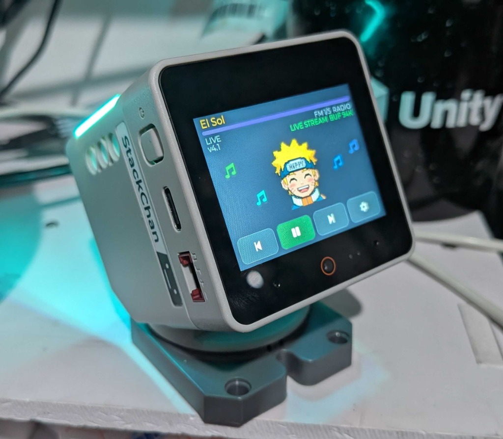

<div align="center">

# StackChan Community Suite

**Modular open-source firmware for M5Stack StackChan (CoreS3 / ESP32-S3)**  
*Offline Music & Radio · Alarm Clock · Gemini Live + Auto-Attach MCP · Custom Community App Store*

[](https://docs.espressif.com/projects/esp-idf/en/v6.1/esp32s3/index.html)
[](https://docs.m5stack.com/en/StackChan)
[](https://github.com/NicolasChicunque/StackChan/releases)
[](LICENSE)

[Apps](#whats-included) · [Quick Install](#quick-install) · [MicroSD Layout](#microsd-card-layout) · [Docs](#documentation) · [Support](#about--support)


</div>

---

## What's Included

Built on top of the official M5Stack StackChan firmware (preserving `AI.AGENT`, `AVATAR`, `DANCE`, `ESPNOW.REMOTE`, `EZDATA`, and `SETUP`), **Community Suite** adds a scrollable 3×3 launcher, a unified top status bar (**Home** + info + **`[- VOL +]`**), MicroSD custom avatars, and four flagship apps:

| App | Highlights |
| --- | --- |
| **`MUSIC`** | Offline `.mp3`/`.wav` player from MicroSD (PSRAM index for 1,000+ tracks), live HTTP/HTTPS Internet Radio, and a built-in **Web Remote + QR code** with Wi-Fi MP3 upload. |
| **`ALARM`** | RTC-backed Alarm Clock, Countdown Timer, and Stopwatch with laps, synthesized + MicroSD `.mp3` ringtones, background wake service, Nightstand mode, pet-to-snooze, and shake-to-stop. |
| **`GEMINI`** | Direct **Gemini Live API** voice assistant over Wi-Fi (`WSS`, no PC required) with hands-free adaptive VAD, voice & pitch presets, plus **Auto-Attach MCP** to escalate coding/workspace tasks to an optional PC host ([architecture](docs/stackchan-mcp-flow.svg)). |
| **`APP.CENTER`** | Built-in **Community / Official** store toggle for Wi-Fi HTTPS OTA switching between firmware packs and standalone apps, plus optional `/sd/apps/` offline caching. |

> **Want more?** Inside `APP.CENTER` (Community tab), install the **Community Labs Pack (12 Apps)**: `FX` Currency, `HEALTH` Water/Break Reminders, `GAMES` Shake-to-Roll Dice, `DECK` Stream Deck, `NFC` Studio, `HOME` Smart Home & IR, `CALENDAR`, `ENGLISH` Streaks, `TRAKT`, `FILES` SD Explorer, `COMPANION` Buddy, and `SENTINEL` CI Monitor.

All apps can be shown or hidden anytime in **`SETUP → Apps → App visibility`**.

---

## Showcase

<div align="center">
  
  <br>
  <sub>Live Internet Radio streaming in <code>MUSIC</code> with custom MicroSD avatar &amp; RGB LED feedback.</sub>
</div>

<!-- GALLERY & YOUTUBE DEMO — Uncomment and update links when ready:
### Video Walkthrough

<div align="center">
  <a href="https://www.youtube.com/watch?v=YOUR_VIDEO_ID">
    
  </a>
</div>

### App Gallery

| Launcher (3×3) | Music & Internet Radio |
| :---: | :---: |
|  |  |

| Alarm & Nightstand | Gemini Live + MCP |
| :---: | :---: |
|  |  |
-->

---

## Quick Install

### 1. M5Burner — 1-Click USB-C Flash *(Recommended)*

1. Open **[M5Burner](https://burner.m5stack.com/)**, select **CoreS3 / StackChan**, and search for **StackChan Community Suite** *(or download `stackchan-community-suite-merged.bin` from [GitHub Releases](https://github.com/NicolasChicunque/StackChan/releases) and flash at offset `0x0`)*.
2. Connect StackChan via USB-C, click **Burn**, and configure Wi-Fi on first boot.
3. Once installed, you can switch to **Community Labs Pack**, standalone apps, or back to the **Official M5Stack** firmware over Wi-Fi via **`APP.CENTER`**.

### 2. Wi-Fi OTA *(Already on Community Suite)*

Open **`APP.CENTER` → Community**, pick any pack or standalone app, and tap **Install**.

### 3. Build from Source *(ESP-IDF v6.1)*

```bash
git clone https://github.com/NicolasChicunque/StackChan.git
cd StackChan/firmware
python3 ./fetch_repos.py
idf.py set-target esp32s3 && idf.py build flash
```

See [firmware/README.md](firmware/README.md) for modular `STACKCHAN_ENABLE_APP_*` CMake flags, `merge-bin` commands, and host-side tests.

---

## MicroSD Card Layout

Format a microSD card as **FAT32** (mounted at `/sd`). Everything is optional — the firmware works out of the box without a card:

| Path on MicroSD | Purpose |
| --- | --- |
| `/sd/music/` *(or `/sd/`)* | `.mp3` and `.wav` files for **`MUSIC`** and **`ALARM`** ringtones (scanned recursively). |
| `/sd/config/gemini.txt` | Free Google AI Studio API key for **`GEMINI`** (cached to NVS; optional line 2: model ID, line 3: voice). |
| `/sd/config/radio.txt` | Custom Internet Radio stations (`Name|StreamURL`, one per line). |
| `/sd/config/store.txt` | Optional custom JSON catalog URL override for **`APP.CENTER`**. |
| `/sd/avatars/avatar_*.bin` | Custom LVGL v9 character sprites (enable in `SETUP → Avatar Style`). See [docs/CUSTOM_AVATARS.md](docs/CUSTOM_AVATARS.md). |
| `/sd/apps/` | Cached `.bin` firmwares for offline switching in **`APP.CENTER`**. |

*(Legacy root paths `/sd/gemini.txt`, `/sd/radio.txt`, and `/sd/store.txt` are also supported.)*

---

## Documentation

| Guide | Description |
| --- | --- |
| [firmware/README.md](firmware/README.md) | ESP-IDF v6.1 build setup, modular CMake app flags, `merge-bin` for M5Burner, and unit tests. |
| [docs/CUSTOM_AVATARS.md](docs/CUSTOM_AVATARS.md) | Convert PNG sprites to LVGL v9 `.bin` files and load them from `/sd/avatars/`. |
| [host/stackchan-mcp/HOST_SERVER_INSTALL_GUIDE.md](host/stackchan-mcp/HOST_SERVER_INSTALL_GUIDE.md) | Optional PC host bridge connecting StackChan's **`GEMINI`** app to Antigravity IDE. |
| [docs/ROADMAP.md](docs/ROADMAP.md) | Completed milestones, hardware sensor ideas, and upcoming improvements. |
| [store/apps.json](store/apps.json) | Live JSON catalog consumed by **`APP.CENTER`**. |

---

## Safety & Disclaimer

> [!WARNING]
> **Hardware safety:** Do not forcibly rotate StackChan's servos by hand while powered, as this can damage the gears or motors.

This is an **unofficial community fork** and is not affiliated with or endorsed by M5Stack. Provided as-is under the [MIT License](LICENSE). You can return to the official M5Stack firmware at any time via `APP.CENTER → Official` or M5Burner.

---

## About & Support

This project is built as a **personal hobby** using my own hardware/resources and **AI-assisted development (vibe coding)**, shared freely for the StackChan community. Bug reports, ideas, and pull requests are always welcome!

<!-- DRAFT SUPPORT LINKS — Uncomment once accounts are created:
If you enjoy this firmware and want to support ongoing hobby development:

[](https://ko-fi.com/YOUR_USERNAME)
[](https://buymeacoffee.com/YOUR_USERNAME)
-->

---

## Upstream & Community Credits

Based on [M5Stack StackChan](https://github.com/m5stack/StackChan) (`upstream` branch kept intact for reference).

- **Hardware & Docs:** [M5Stack Store](https://shop.m5stack.com/products/stackchan-kawaii-co-created-open-source-ai-desktop-robot) · [Official Docs](https://docs.m5stack.com/en/StackChan) · [StackChan-BSP](https://github.com/m5stack/StackChan-BSP)
- **Original StackChan Creators:** [@stack_chan](https://x.com/stack_chan) (Shinya Ishikawa) & [@mongonta555](https://x.com/mongonta555) (Takao Akaki)
