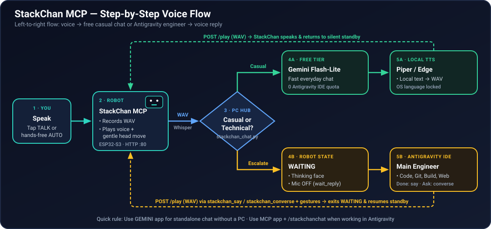

# StackChan MCP Host Server — Install Guide

Optional PC companion setup that connects StackChan's **`GEMINI`** app (Auto-Attach MCP) to **Antigravity IDE**, letting StackChan handle everyday conversation directly on the ESP32-S3 (0 IDE quota) and escalate coding, Git, build, or camera tasks to your PC workspace.

> **Official Antigravity Plugin repo:** **[NicolasChicunque/stackchan-mcp](https://github.com/NicolasChicunque/stackchan-mcp)** (includes `plugin.json`, `mcp_config.json`, `/stackchanchat` skill, and `scripts/stackchan_bridge.py`).

## Architecture Overview



## 1. Requirements

- Python 3.11+, `uv` (`pip install uv`), and FFmpeg
- StackChan running **Community Suite** (`main` branch or latest [GitHub Release](https://github.com/NicolasChicunque/StackChan/releases))
- Free Google AI Studio API key saved in `/sd/config/gemini.txt` on StackChan's microSD card

## 2. Install as an Antigravity Plugin *(Recommended)*

Clone directly into Antigravity's plugins folder so both the `stackchan` MCP server and `/stackchanchat` skill register automatically:

```bash
git clone https://github.com/NicolasChicunque/stackchan-mcp.git ~/.gemini/config/plugins/stackchan-mcp
cd ~/.gemini/config/plugins/stackchan-mcp
uv sync && uv pip install edge-tts
```

*(On Windows PowerShell, use `$env:USERPROFILE\.gemini\config\plugins\stackchan-mcp`.)*

## 3. Configure `.env`

```bash
cp .env.example .env
```

Edit `.env` and set your device IP (shown on StackChan's **`GEMINI`** screen):

```env
STACKCHAN_IP="192.168.1.xxx"
TTS_ENGINE="edge-tts"
```

> **Privacy note:** Keep `.env` local and never commit API keys or tokens. In **Unified `GEMINI` + Auto-Attach MCP** mode (`scripts/stackchan_bridge.py`), speech recognition and casual chat run natively on the ESP32-S3 — no local Whisper or PC `GEMINI_API_KEY` is required.

## 4. Run & Verify

1. Restart Antigravity IDE so the plugin loads.
2. Open **`GEMINI`** on StackChan (displays its local IP and `PC OFF` until attached).
3. In Antigravity IDE, run **`/stackchanchat`** — StackChan switches to `MCP READY` and keeps casual chat on-device while escalating engineering tasks to your workspace.

---

### Legacy Mode (`MCP` App with Local Whisper/Piper)

If you prefer the legacy `MCP` app with local Faster-Whisper ASR and Piper TTS, see the [stackchan-mcp README](https://github.com/NicolasChicunque/stackchan-mcp#readme) and [`stackchan-mcp.env.template`](stackchan-mcp.env.template).
